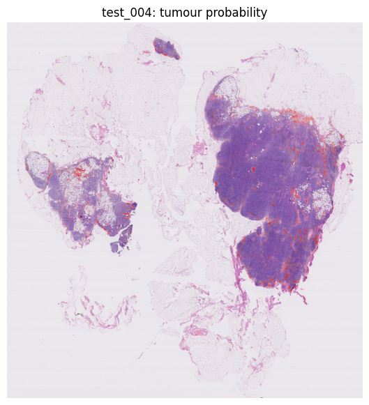
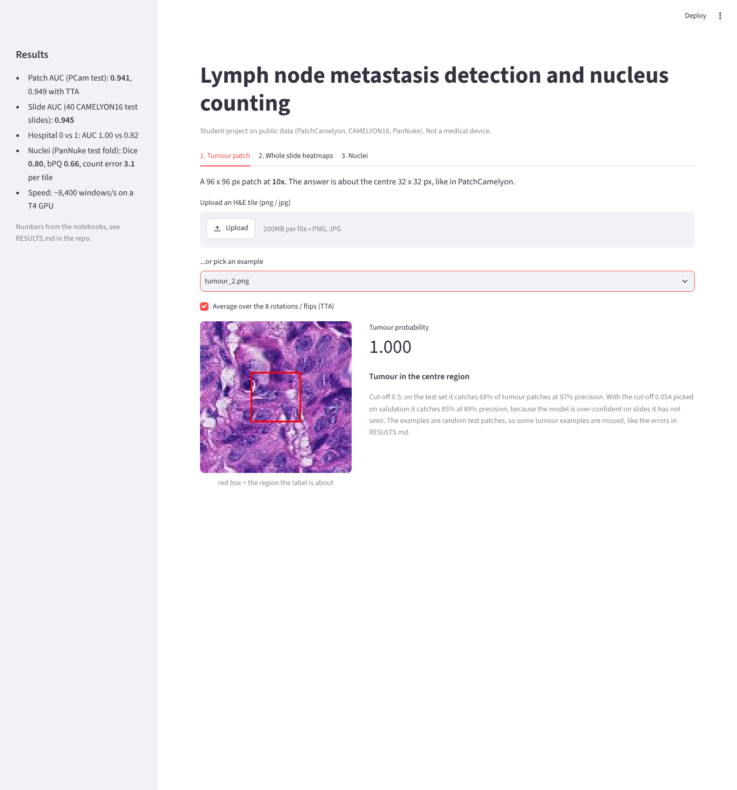
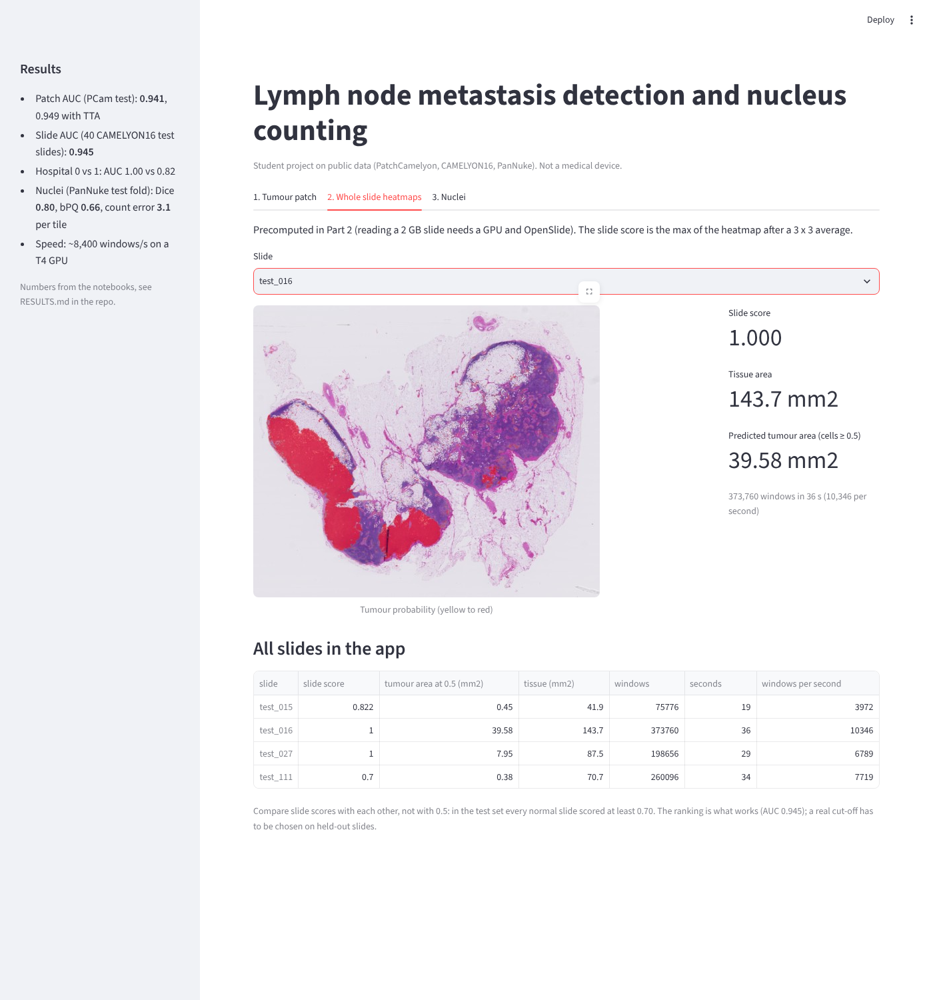
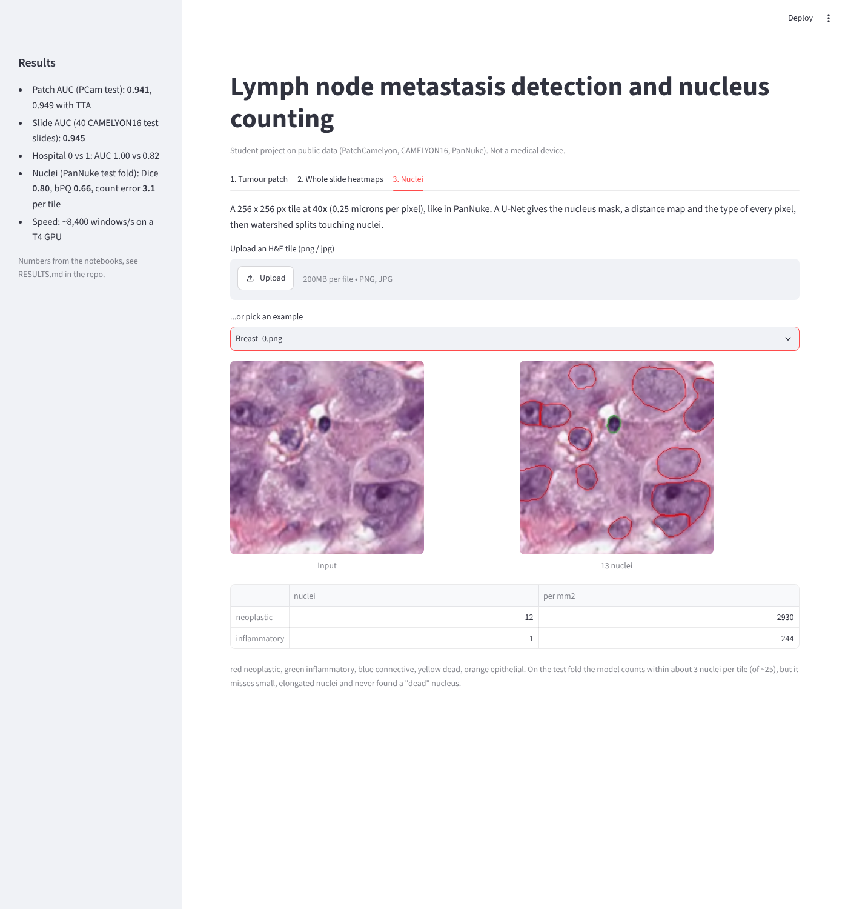

# Gigapixel Pathology Pipeline: Metastasis Detection and Nucleus Counting

Finds cancer that has spread to lymph nodes on whole-slide images: gigapixel scans of about 100,000 × 100,000 px (CAMELYON16). A ResNet-18 trained on 96 px patches (PatchCamelyon) is run over every tissue window of a slide, giving a tumour heatmap, a slide-level score and the tumour regions. A second model, a U-Net on PanNuke, outlines, types and counts the nuclei in tissue tiles.

**PyTorch · OpenSlide · segmentation-models-pytorch · Streamlit · Google Colab (T4)** · [Live app](#) · [Results](RESULTS.md)

> Student project on public data. Not a medical device.



## Results

| | Result |
|---|---|
| Patch classifier (PCam test, 32,768 patches) | **AUC 0.941** (95% CI 0.918 - 0.962), 0.949 with TTA |
| Slide-level detection (40 CAMELYON16 test slides) | **AUC 0.945** (95% CI 0.853 - 1.00) |
| Tumour outline vs pathologist annotation | cell-level AUC 0.986, Dice 0.904 |
| Nuclei (PanNuke test fold, 2,722 tiles) | Dice **0.802**, **bPQ 0.658**, counting error **3.06 nuclei per tile** (~12%), count correlation 0.964 |
| By hospital | AUC **1.00** (hospital 0) vs **0.82** (hospital 1) |
| Speed | **~8,400 windows/s** on a T4, median 28 s per slide, 10.2M windows in ~20 min |

What the numbers say, in short:
- **The ranking works, the 0.5 cut-off doesn't.** 18 of 20 tumour slides score above every normal slide, but every normal slide also scores above 0.70, so a real cut-off has to be chosen on held-out slides.
- **Hospital shift.** Both missed tumour slides are micro-metastases from hospital 1, the same slides that were hardest in the patch test. That points to stain or scanner differences.
- **Nuclei: finding works, typing doesn't yet.** bPQ 0.66 for any nucleus but mPQ 0.32 across the 5 types, and the rare "dead" type is never found (~1.5% of nuclei).
- **Too many small false positives.** At a cell threshold of 0.5 the heatmap finds 139 of 140 lesions, but it also marks hundreds of small regions per slide, mostly along tissue edges.

The full tables, figures and the honest reading are in [RESULTS.md](RESULTS.md).

## How it works

| # | Notebook | What it does | Gives |
|---|---|---|---|
| 1 | [`notebooks/Part1_PatchClassifier.ipynb`](notebooks/Part1_PatchClassifier.ipynb) | Fine-tunes ResNet-18 (ImageNet weights) on 327K PCam patches, with rotations, flips and HED stain jitter done on the GPU. Slide-disjoint splits, threshold chosen on validation, CIs by resampling slides | `pcam_resnet18.pt`, test AUC with CI, error gallery |
| 2 | [`notebooks/Part2_WholeSlide.ipynb`](notebooks/Part2_WholeSlide.ipynb) | Runs the Part 1 model over 40 CAMELYON16 test slides: tissue mask, grid, block reads, heatmap, slide score, lesions vs annotations | heatmaps, slide AUC, per-hospital AUC, speed |
| 3 | [`notebooks/Part3_Nuclei.ipynb`](notebooks/Part3_Nuclei.ipynb) | Trains a U-Net (ResNet-34 encoder) on PanNuke with 3 outputs: nucleus mask, distance map, 5 types. Watershed on the distance map splits touching nuclei. Evaluated with Dice, AJI, PQ and the counting error | `nuclei_best.pt`, bPQ / mPQ / count error |
| app | [`app/app.py`](app/app.py) | 3-tab Streamlit demo: classify a patch, browse slide heatmaps, outline and count nuclei in a tile | the live app |

**From a 2 GB slide file to a score:**
1. **Tissue mask:** a 1/32 thumbnail → HSV saturation → Otsu threshold. Glass is skipped, so only ~20% of the slide is read.
2. **Grid:** 32 px cells at 10×. An integral image (2-D prefix sums) gives every cell's tissue fraction in O(1).
3. **Block reads:** one OpenSlide read per block of 32 × 32 cells, cut into 1,024 overlapping 96 px windows with `tensor.unfold`. Batches run in fp16.
4. **Heatmap:** one probability per cell. The slide score is the max after a 3 × 3 average, fixed before looking at test results.
5. **Lesions:** connected components (BFS) on the thresholded heatmap, compared with the pathologist's XML outlines.

The nuclei model works at 40× (0.25 µm/px), the tumour model at 10×, each at the magnification its labels were made at. Data time and model time are logged separately. On test_004 (98,304 × 103,936 px), 316K windows took 31 s: 6 s waiting for data and 21 s in the model.

## Design points
- **No test leakage:** PCam was cut from CAMELYON16 *training* slides, so Part 2 uses only `test_xxx` slides. Part 1 counts the slides shared between splits (0), and the CIs resample slides, not patches.
- **Thresholds come from validation only:** the 90%-recall threshold in Part 1 was 0.054, and recall fell from 0.90 on validation to 0.85 on test.
- **Slide score fixed in advance:** the smoothed max (AUC 0.945). The raw max would have given only 0.819.
- **Watershed over-splitting handled:** raw distance-map peaks cut one nucleus into several (7 pieces for 4 nuclei in the toy test). Smoothing the map and dropping tiny markers fixed it (4 for 4); `marker_thr` was picked on fold 2 and applied once to fold 3.

## The app

Three tabs, runs on CPU: classify a patch, browse four precomputed slide heatmaps (the slide score, tumour area and speed come with each), and outline, type and count the nuclei in a 40x tile.

| Tumour patch | Whole-slide heatmap | Nuclei |
|---|---|---|
|  |  |  |

## Run it
- **Notebooks:** open them in Colab with a T4 GPU and run top to bottom.
- **App:** the model files are already in `app/artifacts/` (about 74 MB). Install `app/requirements.txt` and start `app/app.py` with Streamlit.

## Repository
```
├── README.md            this page
├── RESULTS.md           all numbers and figures from the executed notebooks
├── guide.md             setting up and deploying the Streamlit app
├── execute.md           running the notebooks on Colab, checks, common errors
├── plan.md              scope, data, leakage traps, interview questions
├── explanation.md       every idea and algorithm in plain words
├── prerequisites.md     what you need before running
├── notebooks/           Part 1, 2 and 3, executed, with outputs
├── app/                 Streamlit app (app.py, requirements.txt, artifacts/)
└── assets/              figures used in README and RESULTS
```

## Future work
- **Rare nucleus types:** the "dead" type is never found. Class-weighted loss or oversampling, then check mPQ again.
- **Nuclei inside the tumour regions:** run the Part 3 model at 40× on tiles taken from Part 2's predicted-tumour and benign areas, and compare counts. Needs 40× reads of the slides, not the 10× used for the heatmaps.
- **Fix the hospital shift:** stain normalization (Macenko) or stronger stain augmentation, checked on hospital 1 alone.
- **Hard-negative mining:** retrain on the false-positive patches along tissue edges to cut the ~610 small false regions per slide.
- **Calibrated cut-offs:** choose the slide and cell thresholds on held-out slides, and report the official CAMELYON16 FROC.
- **Micro-metastases:** patches at 20× or 40×, since both missed slides are micro.
- **All 129 test slides** instead of 40, to narrow the slide-level CI.

## Data
- PatchCamelyon: Veeling et al. 2018, Zenodo record 2546921 (MIT)
- CAMELYON16: Bejnordi et al., JAMA 2017, public AWS bucket `s3://camelyon-dataset` (CC0)
- PanNuke: Gamper et al. 2019/2020, Warwick TIA (CC BY-NC-SA 4.0, non-commercial, so the nuclei model is for research / portfolio use only)
