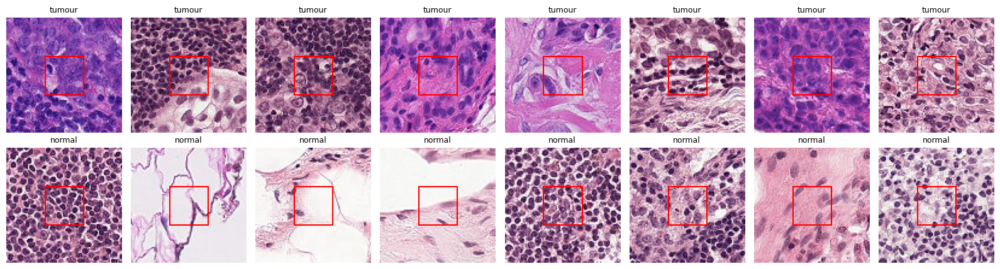
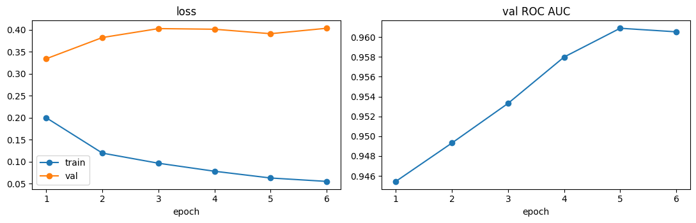
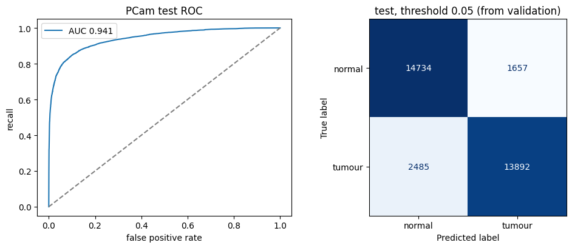
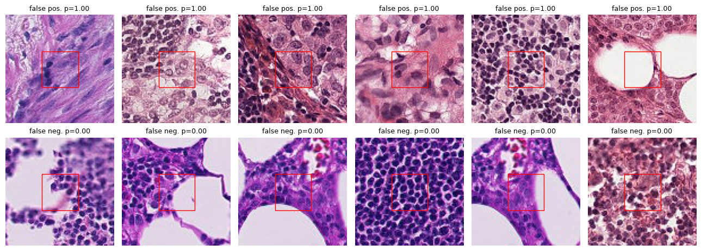
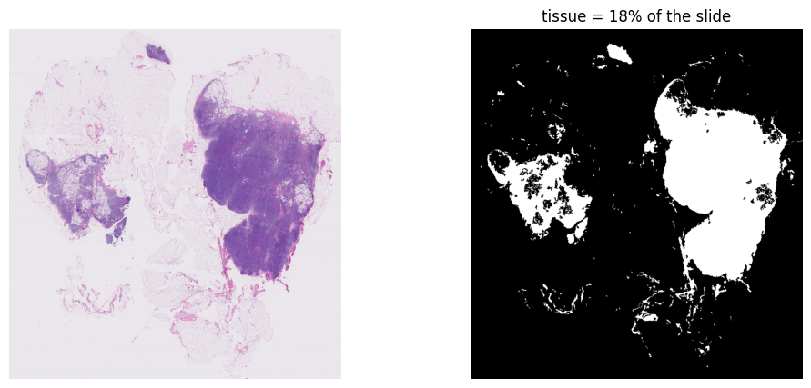
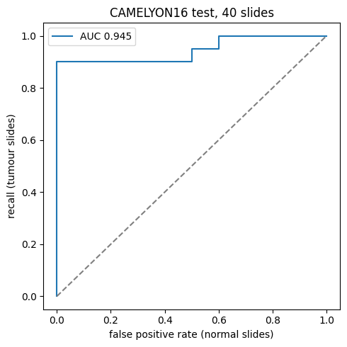
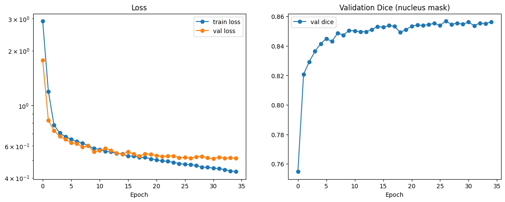
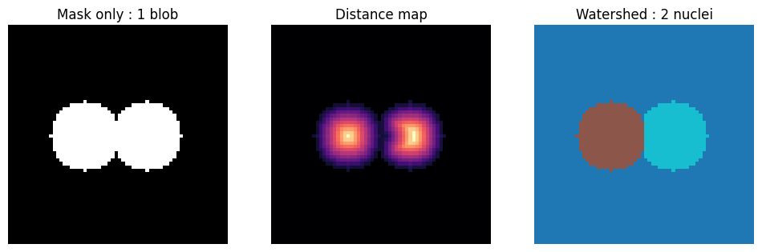
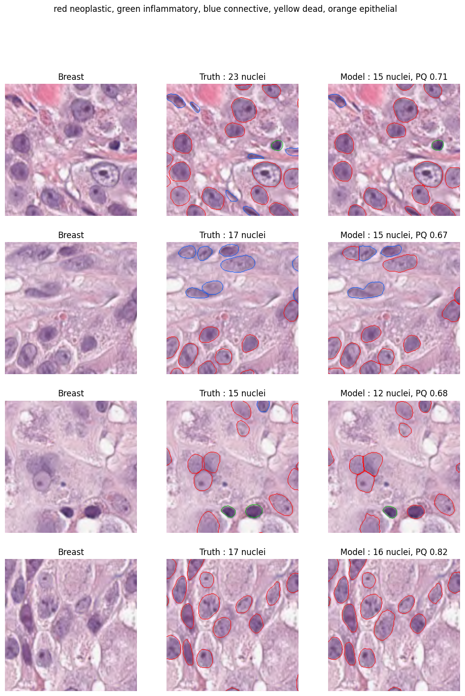

# Results

All numbers come from the executed notebooks (Parts 1, 2 and 3, Colab T4).

## Summary

| | Result |
|---|---|
| Patch classifier (PCam test, 32,768 patches from 129 slides) | **ROC AUC 0.941** (95% CI 0.918 - 0.962), **0.949 with TTA** |
| Slide-level detection (40 CAMELYON16 test slides) | **ROC AUC 0.945** (95% CI 0.853 - 1.00) |
| Tumour outline vs pathologist annotation (cells on tumour slides) | AUC 0.986, Dice 0.904 |
| Nuclei (PanNuke test fold, 2,722 tiles) | Dice **0.802**, AJI 0.679, **bPQ 0.658**, counting error **3.06 nuclei / tile** (correlation 0.964) |
| Speed | 10.2M windows over 40 slides in ~20 min of inference, **~8,400 windows/s** on a T4, median 28 s per slide |
| Leakage | 0 slides shared between train / valid / test |

---

## Part 1: Patch classifier (PatchCamelyon)

### Data
| | Train | Valid | Test |
|---|---|---|---|
| Patches | 262,144 | 32,768 | 32,768 |
| Tumour share | 0.50 | 0.50 | 0.50 |
| Slides | 216 | 54 | 129 |
| Shared slides with the other splits | 0 | 0 | 0 |

The splits are slide-disjoint, so no slide leaks into validation or test.

### Training
ResNet-18 (ImageNet weights, 11.2M parameters), AdamW lr 3e-4, warmup + decay, fp16, batch 256, GPU rotation/flip + HED stain augmentation. About 2.7 min per epoch on a T4.

| Epoch | Train loss | Val loss | Val AUC | Val accuracy |
|---|---|---|---|---|
| 1 | 0.200 | 0.334 | 0.945 | 0.871 |
| 2 | 0.120 | 0.383 | 0.949 | 0.853 |
| 3 | 0.097 | 0.403 | 0.953 | 0.868 |
| 4 | 0.078 | 0.402 | 0.958 | 0.873 |
| **5** | **0.063** | **0.391** | **0.961** | **0.879** |
| 6 | 0.055 | 0.404 | 0.961 | 0.883 |

Best epoch 5 (by val AUC). Val AUC kept improving while val loss rose after epoch 1. The model ranks patches better each epoch, but its probabilities on unseen slides get more over-confident. That gap (train loss 0.06 vs val 0.39) is the domain shift between slides, and it shows up again below.

### Test results
| | Plain | With TTA (8 rotations / flips) |
|---|---|---|
| **ROC AUC** | **0.941** | **0.949** |
| 95% CI (resampling slides) | 0.918 - 0.962 | 0.926 - 0.968 |
| Accuracy at 0.5 | 0.828 | 0.832 |
| Threshold chosen on validation for 90% recall | 0.054 | 0.114 |
| Recall at that threshold: val → test | 0.900 → **0.848** | 0.900 → 0.834 |
| Precision at that threshold (test) | 0.893 | 0.926 |

Confusion matrix (plain, threshold 0.054): TN 14,734, FP 1,657, FN 2,485, TP 13,892. Accuracy 0.874, specificity 0.899.

**What it shows:**
- **The threshold had to be very low (0.054)** to catch 90% of the validation tumour patches. Many tumour patches from unseen slides get low scores, which is the over-confidence seen in the val loss. Accuracy is higher at 0.054 (0.874) than at 0.5 (0.828).
- **Recall dropped from 0.90 on validation to 0.85 on test.** Validation comes from CAMELYON16 training slides, test from other slides scanned separately. It's the same pattern as the chest X-ray model (0.917 → 0.825).
- **TTA adds +0.008 AUC**, inside the CI, at 8× the compute.
- **Errors are concentrated in a few slides.** The worst test slides (accuracy at 0.5) are all tumour-heavy: test_099 0.21, test_013 0.32, test_084 0.35, test_079 0.39. So the misses are mostly tumour patches on particular slides, not random noise.
- **Most confident mistakes:** false positives (p = 1.00) are mostly crowded, large atypical nuclei and stroma. False negatives (p = 0.00) are dense lymphocyte areas and patches at the edge of glass, where the tumour may sit outside the labelled centre.

---

## Part 2: Whole slides (CAMELYON16 test set)

### Data and speed
- 40 test slides (20 tumour: 10 macro, 10 micro metastases; 20 normal), from 2 hospitals (24 + 16 slides).
- Example: test_004 is 98,304 × 103,936 px at 0.227 µm/px (31 GB as raw RGB). Its grid had 623,616 cells of 31 µm, 120,148 with tissue (19%). Only 309 of 624 blocks needed reading.
- Geometry checks passed: integral image = plain sum, and windows cut from blocks == direct reads.
- **Speed:** 316,416 windows in 31 s on test_004 (10,047/s), of which 6 s waiting for data and 21 s model, so the model is the bottleneck, not slide reading. Over all 40 slides: 10.2M windows, ~20 min of inference, median 28 s per slide.

### Slide-level results
The main score (fixed before looking at results) is the max of the 3 × 3-smoothed heatmap.

| Slide score | ROC AUC | 95% CI |
|---|---|---|
| **max after 3×3 smoothing (main)** | **0.945** | 0.853 - 1.00 |
| top-10 mean | 0.921 | 0.826 - 0.992 |
| largest tumour region (mm²) | 0.917 | 0.821 - 0.982 |
| tumour area (mm²) | 0.823 | 0.685 - 0.938 |
| raw max | 0.819 | 0.698 - 0.927 |

| By hospital | Slides | AUC |
|---|---|---|
| Hospital 0 | 24 | **1.00** |
| Hospital 1 | 16 | **0.817** |

**What it shows:**
- **Smoothing matters:** raw max AUC 0.819 vs smoothed 0.945. Every normal slide has some single cells at p ≈ 1.0, and averaging over 3 × 3 removes most of them.
- **At a threshold above the highest normal slide, 18 of 20 tumour slides (90%) are still flagged.** The 2 below it are test_099 and test_084, both **micro-metastases from hospital 1**. These are also among the hardest slides in the Part 1 patch test, so the slide-level failures trace back to the patch model.
- **Hospital shift:** AUC 1.00 at hospital 0 vs 0.817 at hospital 1. Several hospital-1 normal slides score as high as micro-metastases (test_077 0.997, test_044 0.995, test_063 0.994). That points to stain or scanner differences, which stain normalization or more stain augmentation could address.
- **The 0.5 cut-off is useless here:** every normal slide scores ≥ 0.70 (recall 1.0, specificity 0.0). The AUC shows the *ranking* is good, but the threshold would have to be learned on held-out data, near 0.97 for this model.

### Lesion-level results (vs pathologist outlines)
| | Value |
|---|---|
| Cell-level AUC (tumour slides, inside tissue) | **0.986** |
| Cell-level Dice at 0.5 | **0.904** |
| Lesions ≥ 200 µm found | **139 / 140** |
| False-positive regions per slide at 0.5 | **~610** |

**The honest reading:** the heatmap outlines real tumour very well, finding 139 of 140 lesions with Dice 0.90. But at a cell threshold of 0.5 it also fires in hundreds of small specks per slide (150 to 2,482 regions on normal slides), often along tissue edges. Lesion sensitivity is therefore high only because the false-positive rate is very high. The fixes, in order:
1. a higher cell threshold or minimum region size, chosen on held-out slides
2. hard-negative mining (retrain on the false-positive patches)
3. stain normalization for hospital 1

---

## Part 3: Nuclei (PanNuke)

U-Net with a ResNet-34 encoder (ImageNet weights, 24.4M parameters) on PanNuke, 256 × 256 px tiles at 40×. Split by the dataset's folds: fold 1 train (2,656 tiles), fold 2 validation (2,523), fold 3 test (2,722). Three outputs per pixel (nucleus mask, distance map, 5 types), loss = BCE + soft Dice + 2 × MSE (distance) + cross entropy (type), AdamW lr 3e-4, batch 16, fp16, flips and rotations. About 0.8 min per epoch on a T4. Early stopping picked epoch 27 of 35 (best val Dice 0.857).

### Watershed (chosen on validation, applied once to test)
Touching nuclei are split by watershed on the predicted distance map. The distance map is smoothed first, because the raw peaks over-split nuclei.

| `marker_thr` (fold 2) | bPQ | AJI | Counting error (nuclei / tile) |
|---|---|---|---|
| 0.3 | 0.637 | 0.669 | 3.00 |
| **0.4** | **0.641** | **0.675** | **2.94** |
| 0.5 | 0.640 | 0.672 | 2.99 |
| 0.6 | 0.628 | 0.653 | 3.32 |

The score barely changes between 0.3 and 0.5, so the result does not depend on a lucky threshold. Toy test with 4 touching nuclei: cut at 0.5 with no smoothing gives 7 (PQ 0.57), the smoothed version gives 4 (PQ 1.0).

### Test results (fold 3, 2,722 tiles)
| | Value |
|---|---|
| Dice (nucleus mask) | **0.802** |
| AJI | **0.679** |
| bPQ (mean over tissues) | **0.658** |
| DQ / SQ | 0.780 / 0.817 |
| Counting error | **3.06 nuclei per tile** (about 12% of the ~24.5 true nuclei) |
| Correlation, predicted vs true count | 0.964 |
| mPQ (mean over 5 types) | 0.316 |

### Per type
| Type | PQ | Counting error | True nuclei / tile |
|---|---|---|---|
| neoplastic | 0.473 | 3.05 | 10.46 |
| inflammatory | 0.348 | 1.42 | 3.98 |
| connective | 0.344 | 2.51 | 6.41 |
| epithelial | 0.414 | 1.08 | 3.26 |
| dead | **0.000** | 0.39 | 0.39 |

**What it shows:**
- **Finding nuclei works much better than typing them:** bPQ 0.66 (any nucleus) vs mPQ 0.32 (right type). Neoplastic is the best type (0.47), the rarer ones are worse.
- **The "dead" type is never found.** It is only about 1.5% of the nuclei (967 of 63,218 in fold 1), so the model never learns it. The counting error for it (0.39) is the same as the true count. A class-weighted loss or oversampling would be the next step.
- **Counts follow the truth** (correlation 0.964, error about 3 per tile), but individual tiles can be off: in the example figure the model misses small, elongated connective nuclei (15 predicted vs 23 true in the first tile) and merges a few touching ones.
- **Weakest tissues (bPQ):** colon 0.594, skin 0.602, lung 0.615. Colon and head & neck have the lowest Dice (about 0.72).
- **Validation → test:** bPQ 0.641 on fold 2 vs 0.658 on fold 3, so the settings chosen on validation transfer. (The val Dice of 0.857 is over all pixels and the test Dice of 0.802 is the mean per tile, so those two are not directly comparable.)
- **PQ = DQ × SQ:** the model's detection quality (0.78) is lower than its segmentation quality (0.82), so more of the loss comes from missed or merged nuclei than from sloppy outlines.

---

## Limitations
- 40 of the 129 test slides, so the slide-level CI is wide (0.85 - 1.00).
- The nuclei model is trained and tested on PanNuke tiles. It has not been run on CAMELYON16 slides, so counts inside the predicted tumour regions are not reported.
- Nuclei types: the 5-type mPQ is 0.32 and "dead" is never found, so use the counts and the any-nucleus numbers, not the type labels, for claims.
- PCam patches are 10×. Micro-metastases are the weak spot (both missed slides are micro).
- Probabilities aren't calibrated across slides and hospitals: thresholds chosen on one set don't transfer.
- The lesion count is one threshold (0.5) on the 31 µm grid, not the official CAMELYON16 FROC.
- One training run per model, no repeat seeds. PanNuke is used with its standard fold split (train on fold 1 only), so numbers are not directly comparable with papers that use a different fold protocol.
